# 💫 About Me:

Developer · Tech Enthusiast · Creative Mind

⚙️ 1 year of professional experience in IT operations and infrastructure.

🖥️ Worked with computers, servers, networks, hardware and hosting services.

🎬 Video editing is another passion of mine.

🧩 Always experimenting, learning and building something new.

## Stack:

## Development

      

## Databases & Tools

      

## Creative

 ·  · 

## 🌐 Socials:
        
 
# 📊 GitHub Activity:

  
  

## 🏆 GitHub Trophies

  

### ✍️ Random Dev Quote

---

